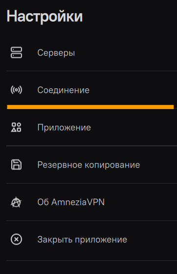
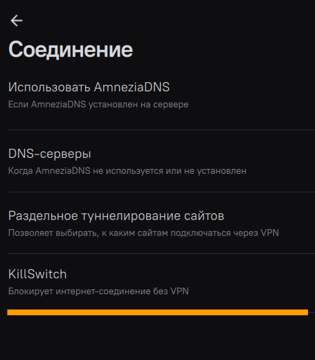
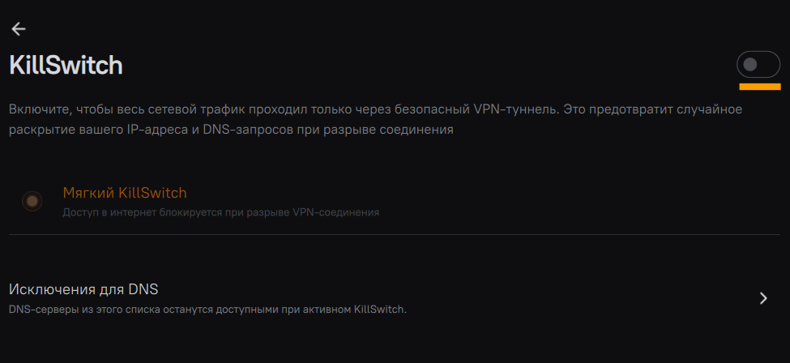
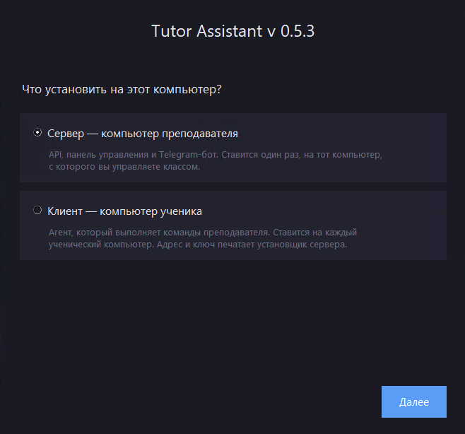
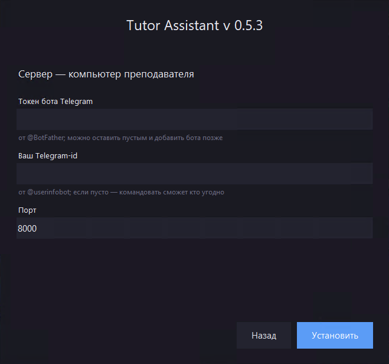
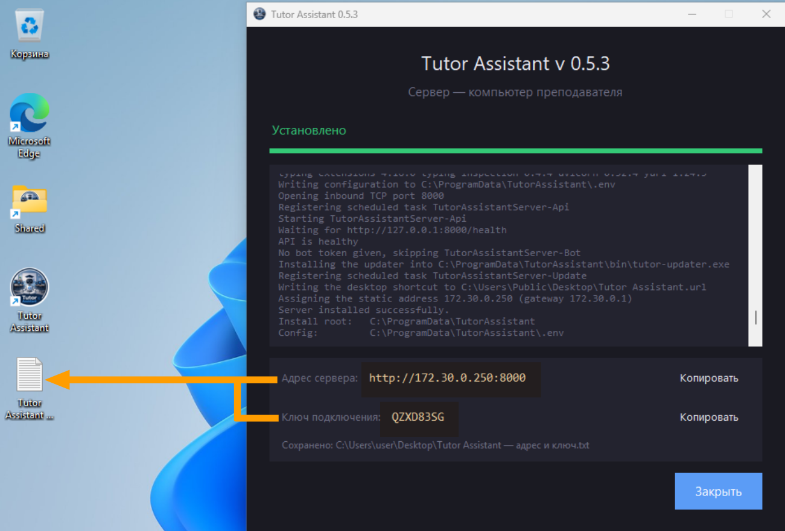
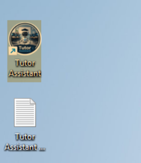
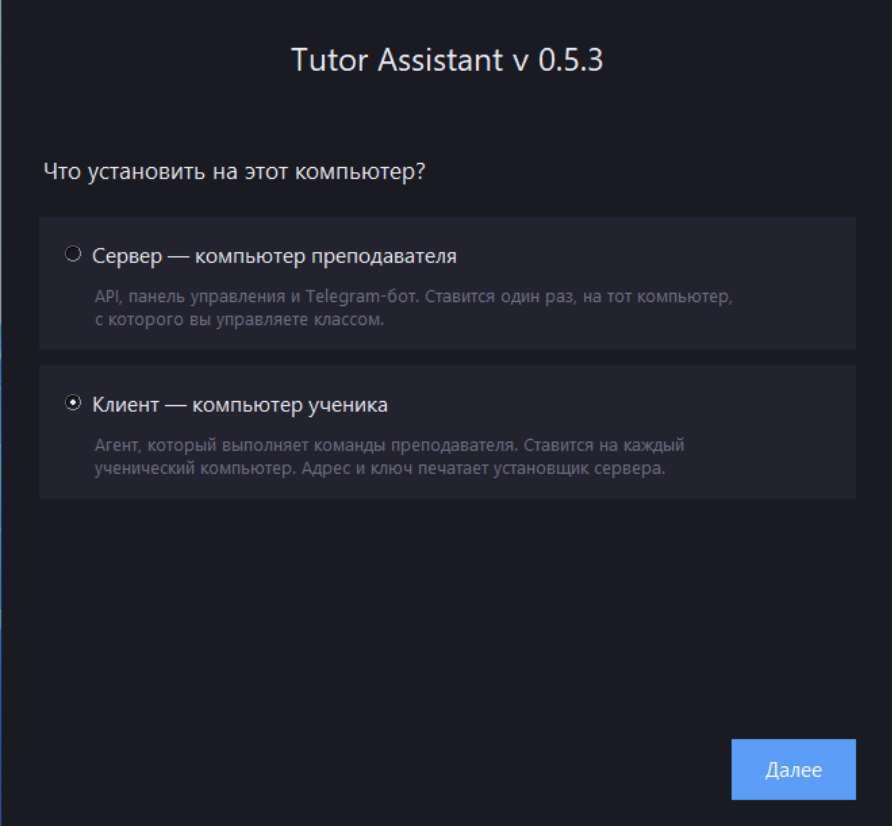
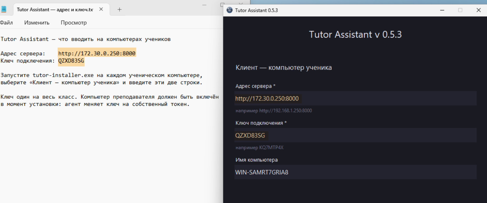
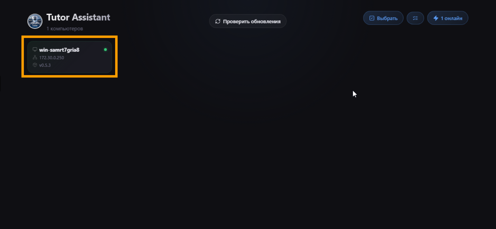

  

<h1 align="center">Tutor Assistant</h1>

  Платформа для управления компьютерами в компьютерном классе:
  сервер с панелью управления, Telegram-бот  и агент на ПК учеников.

  
  
  
  

---

## Что умеет приложение

Tutor Assistant — платформа для учителя, который ведёт занятия в компьютерном классе.
Состоит из трёх процессов, работающих в связке: **сервер** (API + веб-панель),
**Telegram-бот** и **агент**, который ставится на ученические ПК.

- **Управление с телефона через Telegram-бота** , адресно или сразу на весь класс.
- **Веб-панель управления** — тот же функционал в браузере.
- **Ограничения на ученических ПК** — блокировка рабочего стола, персонализации,
  параметров Windows, системных утилит, выхода из системы, установки программ,
  расширений браузера и отключение звука — каждое включается и выключается
  отдельным переключателем.
- **Режим урока** — быстрое применение набора ограничений на время занятия.
- **Экран блокировки поверх всех окон**.
- **Автообновление** — сервер и агент сами обновляются до последнего релиза
  при запуске или по кнопке «Проверить обновления».
- **Отчёт об ошибках прямо из панели** — кнопка «Сообщить об ошибках» открывает готовую
  форму issue на GitHub, ничего не отправляется в фоне и без ведома учителя.

## Скачать

Последний релиз со сборкой `tutor-installer.exe`:

  

> [!IMPORTANT]
> Если VPN (например, AmneziaVPN) используется на сервере или на компьютерах
> учеников, самим VPN пользоваться можно — а вот **KillSwitch** нужно отключить
> на каждом из этих компьютеров перед установкой и работой с Tutor Assistant:
> он заворачивает весь трафик в VPN-туннель и рвёт связь по локальной сети
> между сервером и агентами на компьютерах учеников.
>
> В настройках VPN-клиента: **Настройки → Соединение → KillSwitch** → выключить.
>
> 
> 
> 

## Установка

### Сервер (компьютер преподавателя)

Ставится один раз, на тот компьютер, с которого вы управляете классом:
API, панель управления и Telegram-бот.

1. Запустите `tutor-installer.exe` и выберите **«Сервер — компьютер преподавателя»**.

   

2. Укажите параметры и нажмите **«Установить»**:

   - **Токен бота Telegram** — можно указать уже сейчас (получить у `@BotFather`),
     но управление через Telegram-бота пока
     ,
     поле можно оставить пустым.
   - **Ваш Telegram-id** — можно оставить пустым: если поле пустое, командовать
     сможет кто угодно (актуально после того, как заработает Telegram-бот).
   - **Порт** — `8000` по умолчанию, обычно менять не нужно.

   

3. После установки сервер покажет **адрес** и **ключ подключения** — они нужны для
   каждого клиента (компьютера ученика). Эти же данные сохраняются в файл
   `Tutor Assistant — адрес и ключ.txt` на рабочем столе — сохраните его, он
   пригодится, если понадобится подключить или переустановить агента на новом
   ученическом компьютере.

   

4. Веб-панель управления открывается ярлыком **Tutor Assistant** на рабочем столе.

   

### Клиент (компьютер ученика)

Ставится на каждый компьютер ученика. Агент выполняет команды преподавателя,
подключаясь к серверу по адресу и ключу из установки сервера.

1. Запустите `tutor-installer.exe` на компьютере ученика и выберите
   **«Клиент — компьютер ученика»**.

   

2. Введите **адрес сервера** и **ключ подключения** — они в том самом файле
   `Tutor Assistant — адрес и ключ.txt`, сохранённом на рабочем столе сервера
   (ключ один на весь класс). Поле **«Имя компьютера»** можно оставить как есть
   или задать любое своё — оно нужно только для удобства, потом его в любой
   момент можно переименовать в веб-панели сервера. Нажмите **«Установить»**.

   

3. При успешной установке компьютер ученика появится в веб-панели сервера.

   

> [!WARNING]
> Задержка выполнения команд зависит от загруженности сети и качества сигнала
> Wi-Fi. При слабом сигнале или большой нагрузке на сеть команда может дойти
> до компьютера ученика с заметной задержкой.
